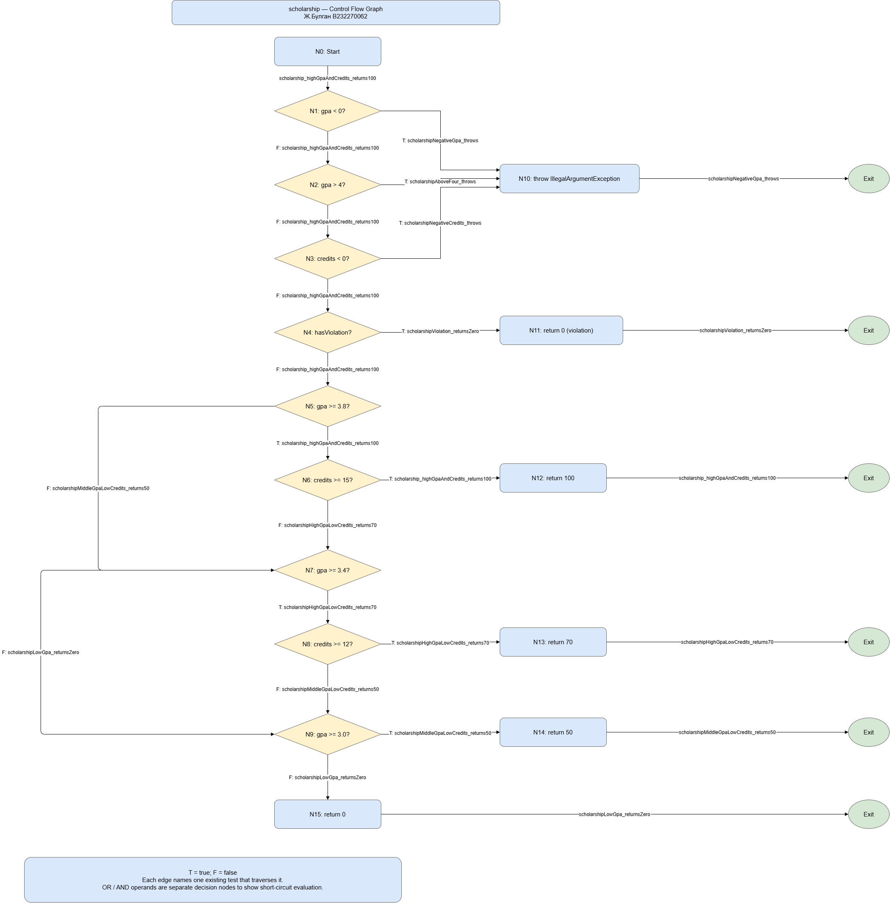

# Лаборатори №9: Код хамралт — JaCoCo

**Оюутан:** Ж.Булган

**Оюутны код:** B232270062

**Хичээл:** F.CSA313 — Программ хангамжийн чанарын баталгаа ба тест (2026)

## Зорилго

ScholarshipCalculator-ийн мөр болон салааны хамралтыг хэмжиж, дутуу замууд, давталтын хил болон үнэлгээний хилийн утгуудыг шалгана.

## Ажлын орчин

### Java

```text
openjdk version "17.0.20.1" 2026-08-18
OpenJDK Runtime Environment (build 17.0.20.1+1-1-26.04-Ubuntu)
OpenJDK 64-Bit Server VM (build 17.0.20.1+1-1-26.04-Ubuntu, mixed mode, sharing)
```

### Maven

```text
Apache Maven 3.9.12
Maven home: /usr/share/maven
Java version: 17.0.20.1, vendor: Ubuntu, runtime: /usr/lib/jvm/java-17-openjdk-amd64
Default locale: en, platform encoding: UTF-8
OS name: "linux", version: "6.18.33.1-microsoft-standard-wsl2", arch: "amd64", family: "unix"
```

## Ажиллуулах

Төслийн үндсэн хавтсанд mvn clean verify ажиллуулна.
HTML тайлан: target/site/jacoco/index.html.

## A. Анхны таван тестийн хамралт

Таван хэвийн оролтын тест ажиллуулахад мөрийн хамралт 16/25 буюу 64%, салааны хамралт 22/41 буюу 53.66% гарсан.
JaCoCo тайланд буруу оролтын exception мөрүүд, C/D/F үнэлгээний буцаалтууд болон тэтгэлэг олгохгүй төгсгөлийн return 0 мөр улаан байгаа нь эдгээр замыг тестүүд ажиллуулаагүйг харуулна.
Оролт шалгах нөхцөлүүд, switch болон тэтгэлгийн нөхцөлүүд шар байгаа нь зарим салаа хамрагдсан боловч бүх үнэн/худал үр дүнг шалгаагүйг харуулна.


## B. Бүрэн хамралт

Анхны 5 тест дээр 15 тест нэмж, нийт 20 тестээр мөр болон салааны 100% хамралтад хүрсэн. Энэ шатанд эх кодыг өөрчлөөгүй.

letterGrade-ийн буруу оролт болон C/D/F замууд, gpa-ийн null/хоосон оролт болон switch-ийн бүх сонголтыг шалгасан.
scholarship-ийн буруу голч, сөрөг кредит, сахилгын зөрчил болон 100/70/50/0 үр дүнг шалгасан.
OR нөхцөлийн хэсэг бүрийг тусгаарласан алдаатай оролтоор, AND нөхцөлийг голч хүрсэн боловч кредит хүрээгүй оролтоор шалгасан.

### scholarship функцийн удирдлагын урсгал



Сум бүр дээр тухайн замаар ажиллах тестийн нэрийг бичсэн. T нь үнэн, F нь худал салаа.
Exit дүрсүүд нь функцээс гарах төгсгөлийг тус тусад нь дүрсэлсэн.
Зургийн загварыг ChatGPT-ээр бэлтгүүлж, draw.io дээр нээн PNG болгон экспортолсон.

## C. Давталтын хил шалгах

| Тест | Оролт | Хүлээгдэх үр дүн |
|---|---|---|
| gpa_zeroElements_throws | Хоосон массив | IllegalArgumentException |
| gpa_oneElement_returnsItsPoints | [95] | 4.0 |
| gpa_multipleElements_returnsAverage | [95, 85, 75, 65] | 2.5 |

Хоосон массивыг давталтад орохоос өмнө хориглож байгааг, нэг элементэд нэг удаа, дөрвөн элементэд олон удаа давтаж зөв голч бодож байгааг шалгав.
Салааны хамралт 100% байсан ч давталтын өөр өөр урттай оролтын нийлбэр болон хуваалтыг зөв гүйцэтгэж байгааг тусад нь батлах шаардлагатай.


## D. Хилийн утгын согог

60, 59.99, 69.99, 0, 100, 89.99, 90 гэсэн долоон утгын тест нэмсэн.
Засварын өмнө 30 тестээс grade60_returnsD ганцаараа унасан: expected: <D> but was: <F>.
Нотолгоо: results/mvn-test-D-fail.txt.

Шалтгаан нь score > 60 нөхцөл яг 60 оноог D үнэлгээнд оруулаагүй байв.
Нөхцөлийг score >= 60 болгон засаж, засварыг тусдаа commit-д хадгалсан.
Дараа нь mvn clean verify ажиллуулахад 30 тест бүгд тэнцсэн.

## Хамралтын харьцуулалт

| Үе шат | Тест | Мөрийн хамралт | Салааны хамралт |
|---|---:|---|---|
| A | 5 | 16/25 (64.00%) | 22/41 (53.66%) |
| B | 20 | 25/25 (100.00%) | 41/41 (100.00%) |
| Эцсийн | 30 | 25/25 (100.00%) | 41/41 (100.00%) |

## Дүгнэлт

Анхны таван тестээр мөрийн 64%, салааны 53.66% хамралт авсан.
Дутуу замуудыг шалгаснаар эх кодыг өөрчлөхгүйгээр хамралтыг 100% болгосон.
Гэвч яг 60 онооны тест D-ийн оронд F буцаах согогийг илрүүлсэн.
Иймээс 100% хамралт нь бүх оролтод зөв үр дүн гарна гэсэн баталгаа болохгүй.
Хамралтыг хүлээгдэх үр дүнгийн шалгалт, хилийн утга болон давталтын уртын тесттэй хамтатган ашиглах шаардлагатай.
Засварын дараа 30 тест тэнцэж, мөр болон салааны хамралт 100% хэвээр үлдсэн.

## AI ашигласан тухай

Тестийн код, команд, CFG загвар болон тайлангийн найруулгад ChatGPT-ийн тусламж ашигласан.
Тестүүдийг өөрийн Ubuntu/WSL орчинд ажиллуулж, үр дүнг Maven гаралт болон JaCoCo CSV тайлангаар шалгасан.
